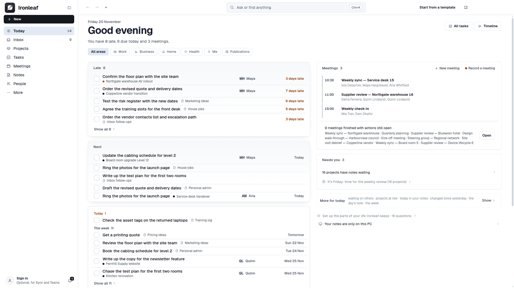
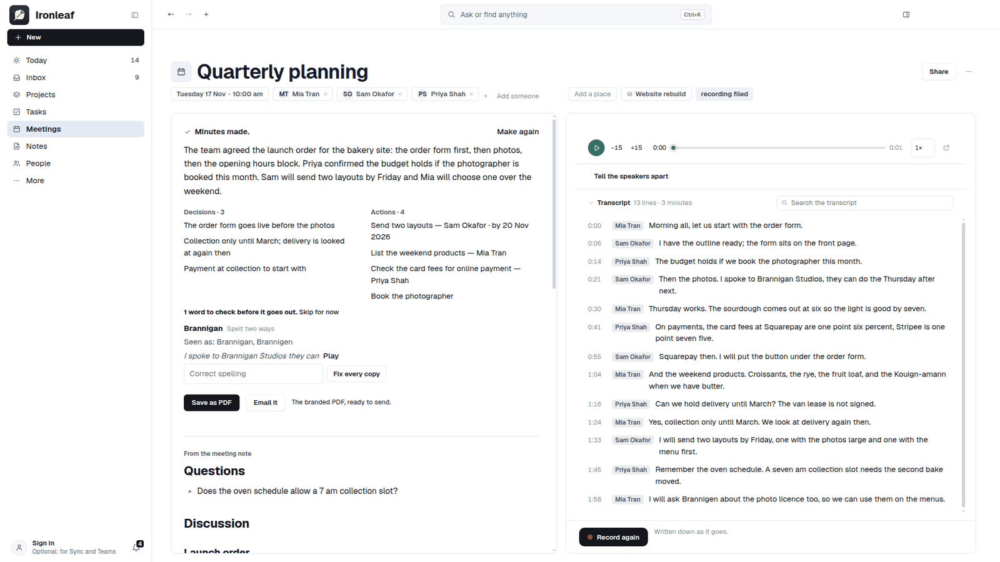
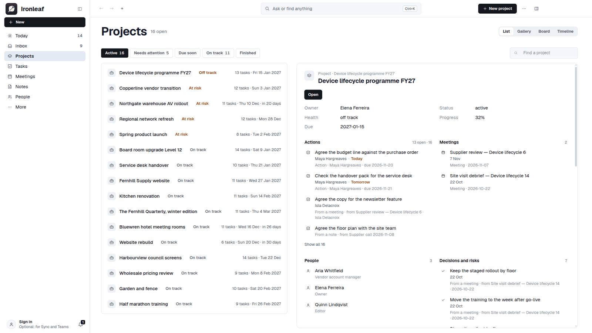
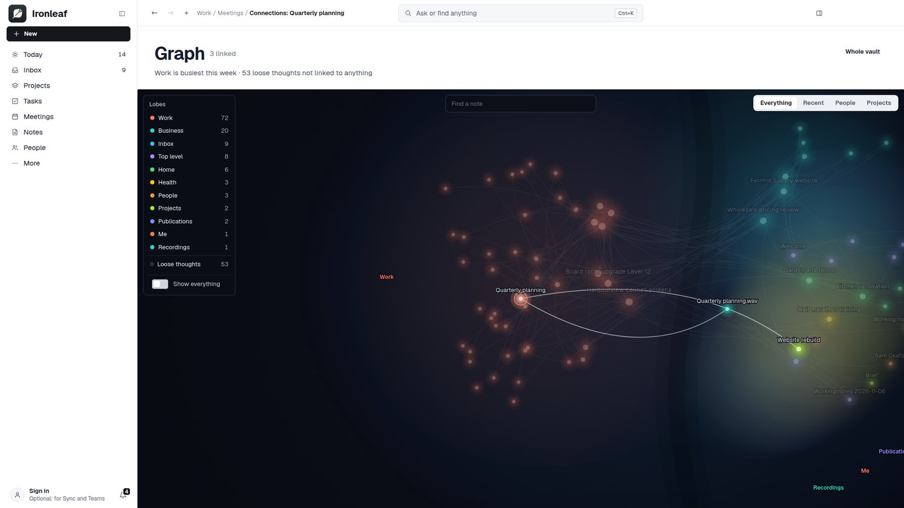

<h1 align="center">Ironleaf</h1>

<p align="center"><b>Your work, your notes, your AI: plain Markdown files on your own computer, organised for you.</b></p>

<p align="center">
  <a href="https://github.com/ironleaf-app/ironleaf/actions/workflows/ci.yml"></a>
  <a href="LICENSE"></a>
  <a href="https://github.com/ironleaf-app/ironleaf/releases/latest"></a>
  
</p>

<p align="center">
  <a href="https://ironleaf.kaitiaki-it.com/download/"><b>Download Ironleaf</b></a> ·
  <a href="docs/MCP.md">Connect an AI</a> ·
  <a href="#build-from-source">Build from source</a> ·
  <a href="#how-ironleaf-is-funded">How it is funded</a>
</p>



Ironleaf is a free, open-source notes app for Windows and Linux. Your notes are ordinary Markdown files in a folder
you choose: no lock-in, no account needed, readable by any text editor. On top of those files Ironleaf keeps your
day, your projects, the people you work with and your meetings in order, and lets the AI you already use work with
them, on your terms.

## What you get

- **Today**: what is late, what is next, today's meetings and what needs you, in one view.
- **Projects**: status, health, next steps, waiting-on-others, decisions and risks, gathered from your notes.
- **People**: everyone you work with, their meetings, the actions they owe you and the ones you owe them.
- **Meetings with minutes**: record a meeting, get a transcript with speakers, then minutes with decisions and
  actions that land on the right projects and people. Telling the speakers apart runs on your PC.
- **Graph and canvas**: see how notes, projects and people connect; lay ideas out on boards saved as JSON Canvas.
- **AI built in, on your own key or a local model**: a side chat beside every note, Ask (a question in the Ctrl+K
  box, answered from your notes with its sources) and meeting minutes, on Anthropic, OpenAI, Gemini, Ollama or any OpenAI-compatible
  endpoint. No Ironleaf middleman, and private notes never reach a model.
- **MCP server with 80 tools**: Claude Desktop, Claude Code, ChatGPT desktop, Cursor, VS Code and other MCP apps can
  search, read and (only if you allow it) change your notes. Every change is listed with Undo.
- **Search by meaning and OCR**, on-device and offline; a quick switcher (Ctrl+O) and every command (Ctrl+K) from
  the keyboard.
- **Lives in the tray**: reminders, backups, sync and AI access carry on when the window is closed.
- **Signed self-updates**: an update installs only if it is signed with Kaitiaki IT's release key.
- **Plain Markdown files**: links, embeds, tags, properties, callouts and canvases that keep working in other
  Markdown notes apps.
- **Optional, paid: Ironleaf Sync and Teams**: end-to-end encrypted sync across your PCs, and shared team vaults.
  They fund development; everything else is free.

<table>
  <tr>
    <td width="50%"></td>
    <td width="50%"></td>
  </tr>
  <tr>
    <td align="center">Meetings: minutes, decisions and actions from the transcript</td>
    <td align="center">Projects: health, actions, people and decisions in one place</td>
  </tr>
  <tr>
    <td colspan="2"></td>
  </tr>
  <tr>
    <td colspan="2" align="center">The graph: how your notes, projects, people and meetings connect</td>
  </tr>
</table>

<sub>Screenshots use a made-up sample vault; every name and company in them is fictional.</sub>

## Download

Installers for Windows (setup .exe) and Linux (AppImage) are at
**[ironleaf.kaitiaki-it.com/download](https://ironleaf.kaitiaki-it.com/download/)** and on the
[GitHub releases page](https://github.com/ironleaf-app/ironleaf/releases). Installed copies update themselves.

## Build from source

Needs Node.js 22 or later and git. On Linux the app needs the usual Electron libraries; the UI walks need `xvfb-run`.

```bash
git clone https://github.com/ironleaf-app/ironleaf.git
cd ironleaf
npm ci                 # also applies the small patch in tools/pi-ai-patches (postinstall)
npm run dev            # the app, with hot reload
npm run typecheck
npm run build          # main, preload and window into out/
npm start              # the built app
```

Installers (AppImage, Windows NSIS) are made by `tools/release.mjs`; see [docs/RELEASING.md](docs/RELEASING.md).
Official builds are signed by Kaitiaki IT; a build you make yourself only updates from where you point it.

## Run the tests

```bash
npm run test:fast      # the unit checks that need no window: what CI runs on Linux and Windows
npm test               # everything, including the UI walks that start the built app (Linux: under xvfb-run)
```

## Connect an AI over MCP

Settings › Connect an AI switches the MCP server on (off by default; Read only until you choose Read and write).
Two ways in: the `ironleaf mcp` command (stdio) for apps that start a server, or the local URL
(`http://127.0.0.1:47731/mcp` with a token) for apps that take an address. Set-up for Claude Desktop, Claude Code,
Cursor, VS Code and ChatGPT desktop, and the list of all 80 tools, are in **[docs/MCP.md](docs/MCP.md)**. Private
notes and secrets are never served, and nothing leaves your machine unless the AI app you connect sends it.

## How Ironleaf is funded

Ironleaf is made by Kaitiaki IT Pty Ltd (Melbourne, Australia). The app is free and open source, and everything one
person needs on their own computer stays free. Development is paid for by:

- **Supporter**: an optional one-off purchase that says thank you and shows a Supporter mark in the app.
- **Ironleaf Sync**: end-to-end encrypted sync of your notes across your PCs (the server never sees names or contents).
- **Ironleaf Teams**: shared team vaults, members and roles, and a team policy applied on every member's PC.
- **Enterprise licence**: a commercial licence (no AGPL obligations), managed deployment, governance and support for
  organisations. See [docs/EDITIONS.md](docs/EDITIONS.md).

Signing in is optional and only needed for these; your notes never need an account.

## How it is put together

```
src/
  main/       the window, the notes folder (vault.ts: every path kept inside it; atomic writes; watching), the index
              (links, backlinks, graph, search, retrieval), file recovery, settings, AI providers, the local MCP
              server, the tray, signed updates, the optional account, Sync and Teams clients
  preload/    the only calls the window can make
  renderer/   the window: workspace (tabs, splits, sidebars), the editor (CodeMirror 6 with Live Preview), pages
              (Today, Projects, People, Meetings, Tasks), canvas, graph, settings
  shared/     types, preferences, Markdown helpers, search, properties and dates used by both sides
```

Security: the window runs sandboxed with context isolation and no Node; every request is checked to come from
Ironleaf's own window; paths cannot leave the notes folder (symlinks included); deleting goes to the Recycle Bin; raw
HTML in notes and answers is never run; the packaged window has a strict Content Security Policy; web links open in
the browser.

Ironleaf is not affiliated with or endorsed by the makers of other notes apps.

## Licence and trademarks

The code is licensed under **AGPL-3.0-or-later** ([LICENSE](LICENSE)); bundled third-party software keeps its own
licences ([THIRD_PARTY_NOTICES.md](THIRD_PARTY_NOTICES.md), [ASSETS.md](ASSETS.md)). If you run a modified Ironleaf
for others over a network, the AGPL asks you to offer them its source. Organisations that cannot accept the AGPL can
get a commercial licence ([docs/EDITIONS.md](docs/EDITIONS.md)).

"Ironleaf" and the leaf logo are trademarks of Kaitiaki IT Pty Ltd. The licence covers the code, not the name or
logo: a fork you distribute must use another name and icon. See [TRADEMARKS.md](TRADEMARKS.md).

## Contributing

Contributions are welcome: see [CONTRIBUTING.md](CONTRIBUTING.md). Contributors sign the
[Contributor Licence Agreement](CLA.md) once, on their first pull request (a bot asks). Please follow the
[Code of Conduct](CODE_OF_CONDUCT.md).

**Built with AI assistance.** Kaitiaki IT builds Ironleaf with AI coding assistants, under human review: every change
is read, tested and merged by a maintainer, and the same checks (typecheck, build and the test suite in CI) apply to
all code, whoever or whatever wrote it.

## Security

Please report vulnerabilities privately to **security@kaitiaki-it.com** or through
[GitHub private vulnerability reporting](https://github.com/ironleaf-app/ironleaf/security/advisories/new),
never in a public issue. See [SECURITY.md](SECURITY.md).
