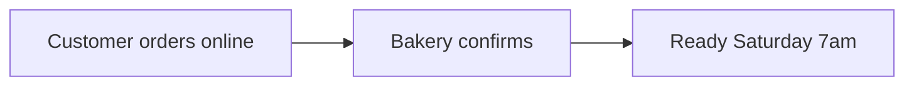

A neighbourhood bakery in Port Fairy moving its orders online. This note is the hub: everything about the project links from here.

## Goals
- Online pre-orders for weekend bread, collected in store
- A simple loyalty card that doesn't need an app
- Weekly specials published from [[Weekly menu]]

> [!tip] What matters most
> Mia wants fewer phone orders on Friday afternoons. Everything else is a bonus.

## Open tasks
- [x] Kick-off with Mia and Sam
- [x] Photograph the counter for the site ![[storefront.png|160]]
- [ ] Draft the order form fields
- [ ] Price the card printing #todo

## Numbers
| Item | Weekly | Price |
| --- | ---: | ---: |
| Sourdough loaves | 180 | $9.50 |
| Croissants | 420 | $4.80 |
| Sausage rolls | 260 | $6.20 |

Margin target is $m = \frac{p - c}{p}$, kept above 0.62.

See also [[Kick-off meeting]] and [[Pricing ideas#Loyalty card]]. Questions waiting on [[Supplier list]].
